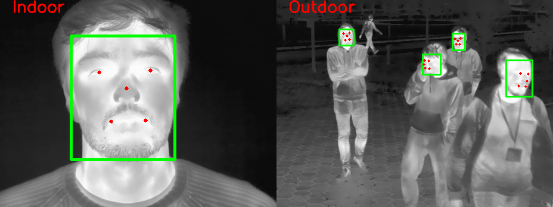
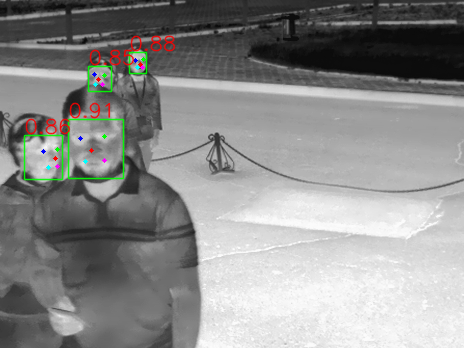

# TFW: Annotated Thermal Faces in the Wild Dataset
The dataset contains thermal images acquired in a  controlled indoor (`c-indoor`), semi-controlled indoor (`s-indoor`), and uncontrolled outdoor (`u-outdoor`) environments. The `c-indoor` dataset was constructed using our previously  published [SpeakingFaces dataset](https://github.com/IS2AI/SpeakingFaces). The `s-indoor` and `u-outdoor` datasets were collected using the same FLIR T540 thermal camera with a resolution of 464x348 pixels, a wave-band of 7.5–14 μm, the field of view 24, and an iron color palette. The dataset was manually annotated with face bounding boxes and five point facial landmarks (the center of the right eye, the center of the left eye, the tip of the nose, the right outer corner of the mouth, the left outer corner of the mouth).

| Environment  | Subjects | Images | Labeled faces | Visual pair|
|  ---:| :---: | :---: | :---: | :---: | 
| c-indoor  | 142  | 5,112  | 5,112  | yes |
| s-indoor  | 9  | 780  | 1,748  | yes |
| u-outdoor  | 15  | 4,090  | 9,649  | no |
| combined  | 147  | 9,982  | 16,509  | yes & no |

Examples of annotated images:



## Paper
[TFW: Annotated Thermal Faces in the Wild Dataset (Open Access)](https://www.techrxiv.org/articles/preprint/TFW_Annotated_Thermal_Faces_in_the_Wild_Dataset/17004538)

[TFW: Annotated Thermal Faces in the Wild Dataset (IEEE)](https://ieeexplore.ieee.org/abstract/document/9781417)

## Video on YouTube
[TFW: Annotated Thermal Faces in the Wild Dataset](https://www.youtube.com/watch?v=QgXi3rLv1jM)

## Dowloading the repository:
```
$ git clone https://github.com/IS2AI/TFW.git
```

## Downloading the dataset 
You can download the dataset from [Hugging Face](https://huggingface.co/datasets/issai/TFW). 

## Data visualization 
- To visualize the `outdoor` dataset:
```
python visualize_dataset.py --dataset PATH_TO_DATASET/TFW/train/ --set outdoor
```
```
python visualize_dataset.py --dataset PATH_TO_DATASET/TFW/test/ --set outdoor
```
```
python visualize_dataset.py --dataset PATH_TO_DATASET/TFW/val/ --set outdoor
```
- To visualize the `indoor` dataset:
```
python visualize_dataset.py --dataset PATH_TO_DATASET/TFW/train/ --set indoor
```
```
python visualize_dataset.py --dataset PATH_TO_DATASET/TFW/test/ --set indoor
```
```
python visualize_dataset.py --dataset PATH_TO_DATASET/TFW/val/ --set indoor
```
## Training
First, convert the TFW dataset to a yolo format using the `dataset2yolo.ipynb` notebook.
Then, follow these steps to train the [YOLOv5](https://github.com/ultralytics/yolov5) models on the TFW dataset: 
1. Clone the repository from Github and install necessary packages:
```
$ git clone https://github.com/ultralytics/yolov5
$ cd yolov5
$ pip install -r requirements.txt
```
2. Copy our `yolov5_tfw.yaml` file into `/yolov5/data` and update paths to the training and validation sets.
3. Train the model on the TFW dataset (change the --img_size to 832 for models with the P6 output block):
```
python train.py --data data/yolov5_tfw.yaml  --cfg models/yolov5s.yaml --weights 'pretrained weights' --batch-size 64 --epochs 250 --img-size 800 
```

To train the [YOLO5Face](https://github.com/deepcam-cn/yolov5-face) models on the TFW dataset:
1. Copy the repository from Github and install necessary packages:
```
$ git clone https://github.com/deepcam-cn/yolov5-face.git
$ cd yolov5-face
```
2. Copy our `yolov5_tfw.yaml` file into `/yolov5-face/data` and update paths to the training and validation sets.
3. Train the model on the TFW dataset (change the --img_size to 832 for models with the P6 output block):
```
python train.py --data data/yolov5_tfw.yaml  --cfg models/yolov5s.yaml --weights 'pretrained weights' --batch-size 64 --epochs 250 --img-size 800 
```

### Pre-trained YOLO5Face thermal face detection models 
| Model  | Backbone | c-indoor<br>AP<sub>50 | u-outdoor<br>AP<sub>50 | Speed (ms)<br>V100 b1|Params (M)|Flops (G)<br>@512x384|
|  ---:| :---: | :---: | :---: | :---: | :---: | :---: | 
| YOLOv5n-Face |ShuffleNetv2| 100  | 95.93 | 10.12 | 1.72 |1.36|  
| YOLOv5n6-Face|ShuffleNetv2| 100  | 95.59 | 13.30 | 2.54 |1.38|  
| YOLOv5s-Face | CSPNet  | 100  | 96.73 | 8.29  | 7.06  | 3.67 |  
| YOLOv5s6-Face| CSPNet  | 100  | 96.36 | 10.86 | 12.37 | 3.75 |  
| YOLOv5m-Face | CSPNet  | 100  | 95.32 | 11.01 | 21.04 | 11.58|  
| YOLOv5m6-Face| CSPNet  | 100  | 96.32 | 13.97 | 35.45 | 11.84|
| YOLOv5l-Face | CSPNet  | 100  | 96.18 | 13.57 | 46.59 | 25.59|
| YOLOv5l6-Face| CSPNet  | 100  | 95.76 | 17.29 | 76.67 | 113.2| 


To use pre-trained `YOLO5Face` models:
  1. Download pre-trained models from [Hugging Face](https://huggingface.co/datasets/issai/TFW) and unzip them in the `yolov5-face` repository folder.
  2. Run `detect_face.py` on terminal:
   ```
  python detect_face.py --weights PATH_TO_MODEL --image PATH_TO_IMAGE --img-size 800
   ```
  3. The result is saved as `result.jpg` in `./yolov5-face/`
  
  
## Demo
    
  
## In case of using our dataset and/or pre-trained models, please cite our work:
  ```
@ARTICLE{9781417,
  author={Kuzdeuov, Askat and Aubakirova, Dana and Koishigarina, Darina and Varol, Huseyin Atakan},
  journal={IEEE Transactions on Information Forensics and Security}, 
  title={TFW: Annotated Thermal Faces in the Wild Dataset}, 
  year={2022},
  volume={17},
  number={},
  pages={2084-2094},
  doi={10.1109/TIFS.2022.3177949}}
  ```
